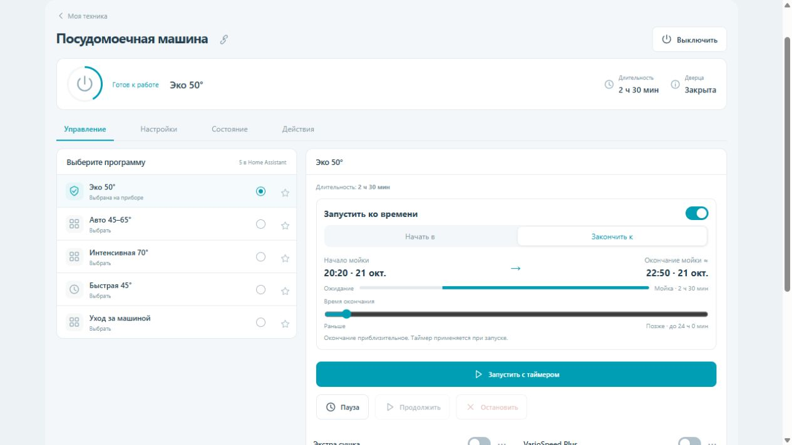

# Home Connect Control Card

A local Lovelace UI for the existing [Home Connect Local integration](https://github.com/Asmir1975/homeconnect_local_hass-UI). No extra container, appliance pairing or credentials.

**[Установка и документация на русском](README.ru.md)**

## Install with HACS

1. Open HACS → ⋮ → Custom repositories.
2. Add `https://github.com/BrainDeLook/homeconnect-control-card` with type **Dashboard**.
3. Find **Home Connect Control Card**, download the latest release and reload your browser.
4. Add a manual card:

```yaml
type: custom:homeconnect-control-card
title: Моя техника
```

If the resource was not registered automatically, add `/hacsfiles/homeconnect-control-card/homeconnect-control-card.js` as a **JavaScript module** under Settings → Dashboards → Resources. Remove any previous `/local/` resource for this card to avoid loading it twice.

This repository is installed as a HACS custom repository; it is not in the default catalog. HACS downloads and updates require internet access. The installed card uses your local Home Assistant connection.



Manual installation: copy `dist/homeconnect-control-card.js` to `/config/www/homeconnect-control-card.js` and register `/local/homeconnect-control-card.js?v=0.1.5` as a JavaScript module resource.

Version 0.1.5. Entity/service compatibility was inspected against integration 1.12.5. Tested with unit tests and a browser fixture simulating Home Assistant; real HA and appliance verification is pending. This is a separate frontend card and does not modify the integration.

Build: `node build.mjs`. Tests: `node --test tests/*.test.mjs`. No npm dependencies.

Dishwashers with a separate start entity select a program immediately when clicked; starting uses its own button. Duration comes from HA sensors, when provided before starting. For START_ONLY profiles use `program_selection: confirm`: integration 1.12.5 does not expose per-program execution modes and its select service can start those programs.

Version 0.1.5 brings a compact main control tab, mobile program picker, and a start/finish-time slider with both timestamps. Scheduling needs a writable StartIn/FinishIn number entity, a known program duration, and the integration `homeconnect_ws.start_program` action. The slider only previews; the start button submits one device-side timer request.
