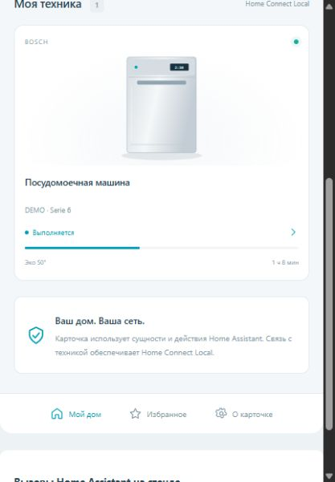

# Home Connect Control Card

Мобильный интерфейс для **Home Connect Local** в Home Assistant: общий экран техники, программы, запуск/пауза/остановка, параметры, настройки и показания. Работает поверх уже существующих сущностей HA. Отдельный сервер, Docker-контейнер, аккаунт, импорт профилей и повторное сопряжение для карточки не нужны.

Первая версия **0.1.0**. Совместимость проверена по исходникам [Asmir1975/homeconnect_local_hass-UI](https://github.com/Asmir1975/homeconnect_local_hass-UI), версия **1.12.5**, commit [`f20fecf`](https://github.com/Asmir1975/homeconnect_local_hass-UI/tree/f20fecfa5918b5245793aef0041167b60359736d). Первый целевой прибор: Bosch Dishwasher **SMV6ECX51E**. Программы и функции для этой модели не выдумываются: карточка берёт их из вашей HA-интеграции.

**Проверка на настоящем Home Assistant и физической SMV6ECX51E ещё не проводилась.** Проверены сопоставление сущностей и формирование действий, а также браузерный стенд с имитацией API HA. Список функций зависит от того, что предоставляет интеграция вашему прибору.

## Установка через HACS

1. Откройте **HACS → ⋮ → Пользовательские репозитории**.
2. Вставьте `https://github.com/BrainDeLook/homeconnect-control-card`, выберите тип **Dashboard / Панель** и добавьте репозиторий.
3. Найдите **Home Connect Control Card** в HACS и скачайте последнюю версию.
4. Обновите страницу HA. При необходимости очистите кеш интерфейса в приложении Home Assistant.
5. На панели добавьте **Ручную карточку**:

```yaml
type: custom:homeconnect-control-card
title: Моя техника
```

Карточка автоматически найдёт приборы платформы **`homeconnect_ws`**. Для одной посудомойки заполнять идентификаторы вручную не нужно. После загрузки ресурса доступен визуальный редактор **Home Connect Control**.

Если HACS не добавил ресурс автоматически, откройте **Настройки → Панели управления → ⋮ → Ресурсы** (нужен расширенный режим в профиле) и добавьте:

- URL: `/hacsfiles/homeconnect-control-card/homeconnect-control-card.js`
- Тип: **Модуль JavaScript**

Если ранее устанавливали карточку вручную, удалите прежний ресурс `/local/homeconnect-control-card.js`, чтобы не загружать две копии.

Это пользовательский репозиторий HACS; в общий каталог он пока не включён. Интернет нужен для скачивания и обновления через HACS. После установки карточка работает через локальный HA.



Для отдельного экрана техники используйте вкладку типа **Panel** — пример в `example-dashboard.yaml`. Обычные разделы и masonry также поддерживаются.

### Ручная установка

Скачайте `homeconnect-control-card.js` из последнего релиза и скопируйте в `/config/www/homeconnect-control-card.js`. Добавьте ресурс `/local/homeconnect-control-card.js?v=0.1.0` типа **Модуль JavaScript**, обновите страницу и добавьте карточку из примера выше. При первом создании каталога `www` может потребоваться перезапуск HA.

## Как устроено управление

- Карточка читает реестры устройств и сущностей HA и выбирает платформу `homeconnect_ws`. Прибор определяется через `device_id`, функции — через стабильный `unique_id`/`translation_key` интеграции. Переименование `entity_id` не ломает автоматическую привязку.
- Названия программ — из `attributes.options` существующей сущности `select_program`. Для известных ключей отображается читаемая подпись, но в действие передаётся **исходное значение option**, а не переведённый текст.
- Нажатие на программу только открывает её в интерфейсе. **Применить программу** вызывает `select.select_option` после подтверждения. В этой интеграции некоторые приборы запускают программу сразу при её выборе; поэтому предупреждение показано всегда.
- **Запустить / Пауза / Продолжить / Остановить** используют существующие кнопки интеграции через `button.press`. Если кнопка недоступна в HA, она заблокирована и здесь. Удалённый запуск дополнительно учитывает `binary_remote_start_allowed`, если эта сущность присутствует.
- Числовые параметры используют `number.set_value` с текущими `min`, `max`, `step` и единицами измерения **Home Assistant**. Для времени не предполагается, что HA всегда показывает секунды.
- Переключатели используют `switch.turn_on` / `switch.turn_off`. Опции `select` используют `select.select_option`. Поддержаны питание, яркость света и скорость/режимы вытяжки через стандартные действия HA.
- `readonly: true` отображается как **Только чтение**, изменение блокируется. Поле `readonly` также помогает отличать параметры текущей программы от настроек прибора.
- При просмотре другой программы параметры текущей программы блокируются, пока выбранный вариант не применён и не появился в состоянии HA. Для следующей программы карточка не отправляет набор параметров от предыдущей.
- Через **⋯** открывается родное окно сущности HA: там доступны дополнительные возможности, история и сложные контролы, например параметры цвета света.
- Избранное хранится в текущем браузере/приложении. Выбор программы из избранного только открывает её, не запускает автоматически.

Команды не повторяются автоматически, не сохраняются в офлайн-очередь и не меняют отображаемое состояние прибора оптимистично. После успешного ответа сервиса карточка ожидает обновления сущностей. Ответ действия HA сам по себе не является подтверждением физического запуска программы.

## Отображение на телефоне

Откройте панель в мобильном приложении **Home Assistant** или добавьте Home Assistant на главный экран браузера. Карточка является частью интерфейса HA и использует его авторизацию и соединение. Все изображения, стили и скрипты содержатся в одном JS-файле; CDN, шрифтов из интернета и отдельной PWA здесь нет.

Для работы без интернета телефон должен иметь локальный доступ к HA, а ваша интеграция — локальный доступ к посудомойке. Карточка не создаёт соединений с Bosch/Siemens и не получает ключи прибора.

## Дополнительная конфигурация

Выбор и порядок устройств, своё название:

```yaml
type: custom:homeconnect-control-card
title: Моя техника
devices:
  - ВАШ_DEVICE_ID_ИЗ_HA
device_names:
  ВАШ_DEVICE_ID_ИЗ_HA: Посудомойка Bosch
appliance_types:
  ВАШ_DEVICE_ID_ИЗ_HA: Dishwasher
show_summary: true
show_hidden: false
```

`device_id` — внутренний идентификатор устройства HA, **не E-Nr и не entity_id**. Он виден в URL страницы устройства: `/config/devices/device/…`. Если `devices` не указан или пуст, показаны все устройства `homeconnect_ws`. Отключённые в реестре сущности карточка не включает и самостоятельно не активирует.

Ручные привязки нужны только при отсутствии доступа к реестрам или несовпадении версии интеграции. Пример с условными именами, которые надо заменить своими:

```yaml
type: custom:homeconnect-control-card
entities:
  ВАШ_DEVICE_ID_ИЗ_HA:
    program: select.bosch_program
    active: sensor.bosch_active_program
    operation: sensor.bosch_operation_state
    progress: sensor.bosch_program_progress
    remaining: sensor.bosch_remaining_program_time
    door: binary_sensor.bosch_door_state
    remote: binary_sensor.bosch_remote_start_allowed
    power: switch.bosch_power_state
    start: button.bosch_start_program
    pause: button.bosch_pause_program
    resume: button.bosch_resume_program
    stop: button.bosch_abort_program
appliance_types:
  ВАШ_DEVICE_ID_ИЗ_HA: Dishwasher
```

Если HA уже отдал реестр, ручная привязка не может перехватить сущность другого прибора или другой интеграции. Если учётная запись не может читать реестры, доступны только явно перечисленные сущности; полного автоподбора дополнительных параметров в таком режиме нет.

## Если что-то не появилось

1. Проверьте, что прибор уже работает в интеграции **Home Connect Local 1.12.5** и его сущности доступны в HA.
2. Нажмите кнопку обновления в заголовке карточки после изменения реестра. Сама карточка также подписывается на его обновления.
3. Проверьте, не скрыта/отключена ли нужная сущность в HA. Скрытые можно включить в показ через редактор; отключённые включаются вручную в настройках HA.
4. Для проверки привязки конкретно к SMV6ECX51E полезна диагностика этой интеграции: **Настройки → Устройства и службы → Home Connect Local → посудомойка → Скачать диагностику**. Полный ZIP профиля с ключами для настройки карточки не нужен.

Ограничение текущей версии: общий список программ HA не сообщает, какие из них `START_ONLY`, поэтому подтверждение выбора всегда предупреждает о возможном немедленном запуске. Карточка не обращается к приватному состоянию интеграции, не изменяет её Python-код и не обходит ограничения прошивки.

## Разработка

Node.js 22+; зависимостей npm нет:

```sh
node --test tests/core.test.mjs
node build.mjs
```

Сборка создаёт один файл `dist/homeconnect-control-card.js`. Стенд интерфейса:

```sh
python -m http.server 8766 --bind 127.0.0.1
```

Откройте `http://127.0.0.1:8766/demo/`. На стенде используются вымышленные приборы, внизу страницы видны точные вызовы имитации API. Стенд не подключается к настоящему HA или бытовой технике.

Проверки: автоматическое обнаружение и переименование сущностей, disabled/hidden, `readonly`, кнопки со значением `unknown`, точные сырые option, границы и шаг чисел, Remote Start, недоступность HA, отсутствие повторов при ошибках, контроль целевого прибора, единицы времени, свет и вентилятор. Проверка в реальном HA и на физической технике остаётся отдельным этапом.

Основано на публичных API [карточек HA](https://contributors.home-assistant.io/frontend/custom-ui/card/) и проверенных сущностях [интеграции Asmir1975](https://github.com/Asmir1975/homeconnect_local_hass-UI). Неофициальный интерфейс, не связан с BSH. Код и графика оригинального APK не используются.
